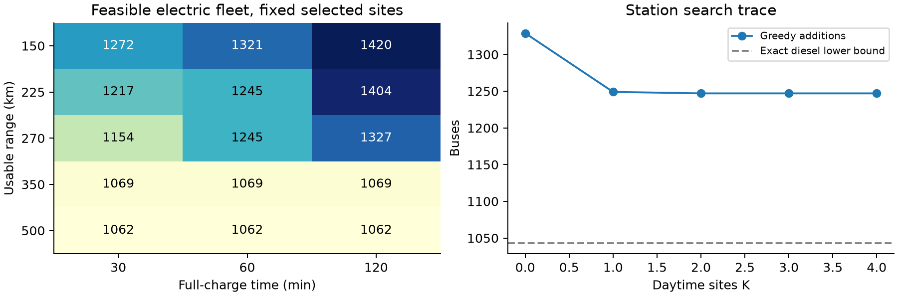
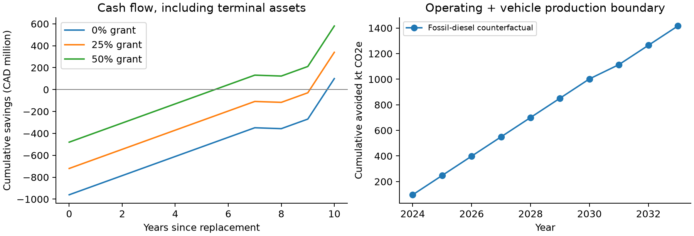
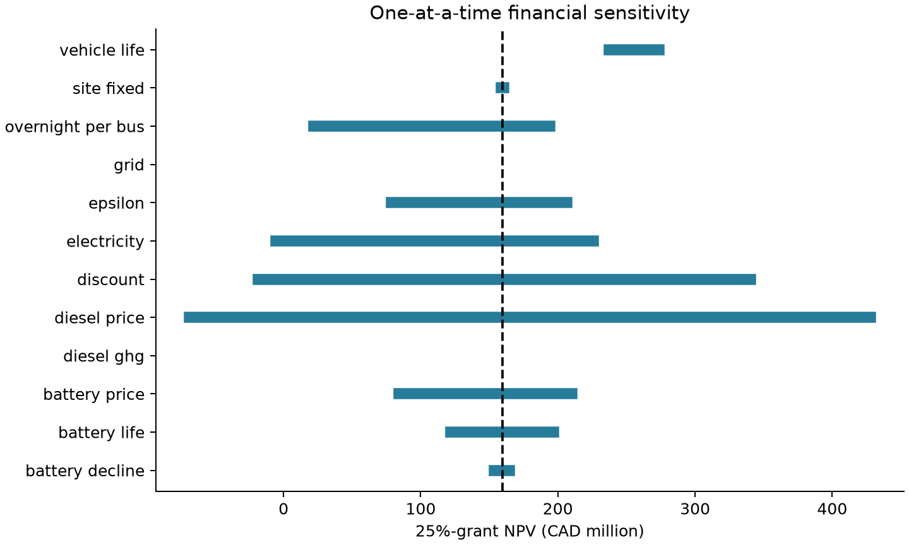
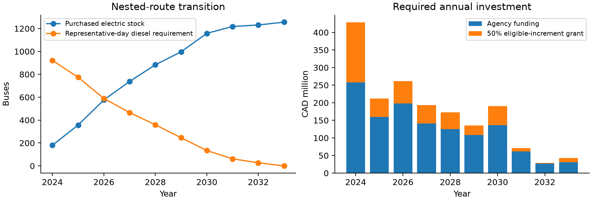
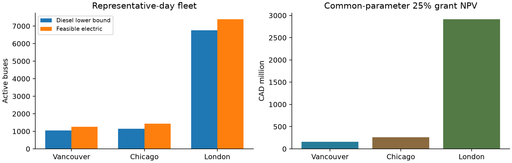
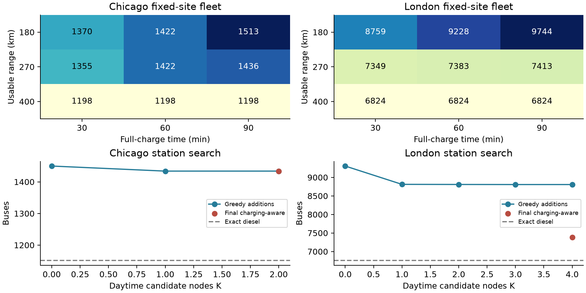

# Summary Sheet

Charging Ahead: A Two-Constant, Timetable-Preserving Transition

Modeling solution for 2023 HiMCM Problem B. Prepared 22 October 2026.

We model electric buses using usable range R and full-charge duration T. Every included timetable trip must be served exactly once at its published time. Exact diesel matching provides a lower bound; range blocks, resource-aware linking and station search construct feasible electric duties.

The existing fall-2023 TransLink data provide the primary case. The representative day has 19,967 trips. At R = 270 km and T = 60 min, the exact diesel baseline is 1,043 buses; the electric heuristic uses 1,247 buses and 4 daytime charging nodes. Across all 25 service patterns, the largest tested electric requirement is 1,256 active buses. These are conditional model outputs, without spares or depot certification.

On 300 independent random instances, the improved heuristic equals the exact optimum in 252 cases; its maximum excess is 2 buses. All 200 infinite-range tests agree with exhaustive search. A three-block counterexample reveals why the reference algorithm must preserve incoming charging-detour mileage through the next block.

Against a homogeneous fossil-diesel counterfactual, the stated vehicle-production and operating boundary avoids 1,416.2 kt CO2e over ten years. Net present savings are CAD -80.3, 159.8 and 399.9 million under 0%, 25% and 50% support of the eligible capital increment. The zero-source electricity case is reported separately from the grid-average diagnostic.

The same engine processed recovered 2023 CTA and London bus timetables: representative-day diesel/electric pairs are 1,151/1,434 in Chicago and 6,755/7,383 in London. Each nested-route illustration reaches zero modeled diesel trips by 2033. Comparator financial screens use common transferred parameters and are not local investment forecasts. Full AI transcripts are missing, so contest disclosure remains incomplete.

Keywords: electric bus scheduling; matching; charging sites; lifecycle boundary; external funding.

# Contents

I. Problem Statement, Evidence, and Scope ...... 3

II. Data, Assumptions, and Notation ...... 4

III. Timetable-Preserving Scheduling Model ...... 5

III.A. Correcting the Reference Algorithm ...... 6

III.B. Validation and Optimality Gaps ...... 7

IV. Vancouver Results Across Service Patterns ...... 8

IV.A. Charging Sites and Recharge Requirements ...... 9

IV.B. Fleet Sensitivity ...... 10

V. Ecological Model and Results ...... 11

VI. Financial Model ...... 12

VI.A. Financial and Carbon Results ...... 13

VI.B. Financial Sensitivity ...... 14

VII. Ten-Year Nested-Route Roadmap ...... 15

VII.A. Staged Investment and Implementation Gates ...... 16

VIII. Three-City Comparison ...... 17

VIII.A. Common-Parameter Transfer and Annual Stages ...... 18

VIII.B. Speed, Sensitivity, and Inventory Boundary ...... 19

IX. Strengths, Limitations, and Completion Status ...... 20

X. Letter to Transportation Officials ...... 21

References: data and problem sources ...... 22

References: accounting and methods ...... 23

References: acquired comparator timetables ...... 24

Report on Use of AI ...... 25

# I. Problem Statement, Evidence, and Scope

The problem asks for ecological and financial models, up to 50% external funding, a ten-year all-electric transition by 2033 in three metropolitan areas, and a one-page official letter [1]. We reconstruct a 2024-2033 scenario around 2023 service. Later publications are retrospective evidence, not information silently assumed available in 2023.

| Area | Eligibility and fleet evidence | Implemented boundary |

| --- | --- | --- |

| Vancouver | 2,642,825 CMA residents in 2021 [2]; mixed fleet in 2023 [3] | Timetable scheduling and scenario accounting |

| Chicago | 2,746,388 city residents in 2020 [4]; 1,875-bus year-end inventory [5] | 2023 CTA bus timetable plus separate fleet cohorts |

| London | Greater London census population exceeds 8 million [6]; 950 electric of 8,643 buses [7] | 2023 bus trips touching Greater London; separate TfL cohorts |

Service preservation means exact departure and arrival obligations. Capacity is assumed equal between modeled diesel and electric vehicles. Individual passenger observations are absent, so exact trip coverage does not prove that actual crowding limits are satisfied.

The problem defines an e-bus through zero-emissions electricity for propulsion and accessories. A low annual grid factor does not certify this. We show a zero-source case conditional on verified procurement and a nonzero grid-average diagnostic. The transferred electricity intensity includes electric cabin heat.

The architecture follows the user-supplied Claude specification and reference program [15], within the EVSP family studied by Wen et al. [20]. Codex assistant sessions (deepseek-flash, following earlier GPT-6 turns) assisted implementation, verification and drafting [16]. Contributions are disclosed in the appendix; missing transcript text is not invented.

# II. Data, Assumptions, and Notation

The recovered TransLink feed is 23SEP_20231020, declared for 4 September-31 December 2023 [8]. The adapter uses the existing cleaned trip manifest, calendar and exceptions. Times beyond 24:00 remain on the service-day clock. Stop IDs are not merged by name.

| Input | Central treatment | Evidence status |

| --- | --- | --- |

| Times / endpoints | Preserved trip obligations | Published schedule, not actual operations |

| Trip distance | Audited upper interval endpoint | Derived bound; lower endpoint tested |

| Travel matrix | 1.35 x great-circle km; 30 km/h | Assumed road detour and speed |

| Candidate sites | 534 endpoint IDs | Coordinates observed; buildability unknown |

| Trolley service | Retain cap47/cap70 proxy separately | Existing proxy, not propulsion roster |

| Capacity / vehicle types | Homogeneous, equal capacity | No individual load or axle verification |

| R / T | 270 km / 60 min | Chosen usable range and charge duration |

| Energy / efficiency | 1.60 kWh/km / 90% | Historical all-electric transfer [9] / assumption |

| Night / depot | Full at first trip; no pullout or pullin | Single-day boundary; cross-day closure absent |

| Charging capacity | Unlimited in solver; count slots afterward | No utility or site certificate |

The travel-time matrix is metric. This ensures a route via a charger is not faster than the direct transfer, which is necessary for the diesel lower-bound proof. A regression test shows that arbitrary nonmetric inputs can violate that bound.

All 25 distinct service patterns are evaluated separately. We use their maximum fleet requirement and retain their frequencies over 119 days. Annual activity is multiplied by 365/119. It is a seasonal extrapolation, not observed annual mileage.

    B_use = epsilon*R; B = B_use/u
    P_battery[kW] = 60*B_use/T_minutes
    P_grid = P_battery/eta

With u = 0.8, the central battery is 540 kWh and grid-side charging power is 480 kW. The factor 60 corrects the minute/hour mismatch. A partial battery still occupies the charger for T, but receives only the energy consumed since its last full charge.

# III. Timetable-Preserving Scheduling Model

Trip i has origin o_i, destination d_i, departure s_i, arrival e_i and service length ell_i. A bus duty is a sequence of trip IDs and C(v) charge tokens. Each trip appears exactly once. Station set S has at most K nodes.

    Direct connection i -> j:
    e_i + tau(d_i,o_j) <= s_j
    u_i + w(d_i,o_j) + ell_j <= R
    u_j = u_i + w(d_i,o_j) + ell_j

    Connection through c in S:
    u_i + w(d_i,c) <= R
    e_i + tau(d_i,c) + T + tau(c,o_j) <= s_j
    w(c,o_j) + ell_j <= R
    u_j = w(c,o_j) + ell_j

The first trip begins fully charged at its origin and must itself fit within R. Both charging detour legs consume range. P1 minimizes duties for fixed S; P2 also chooses S. The heuristic solves these objectives approximately and returns feasible upper bounds.

The diesel compatibility graph includes i-to-j whenever its direct time condition holds. Positive trip durations make it acyclic. A matching of M arcs joins n trips into n-M paths; every path cover supplies such a matching. Thus maximum matching gives the exact minimum diesel fleet [17].

    N_d = n - maximum_matching_size
    PVR = max_t count{s_i <= t < e_i}
    N_e >= N_d >= PVR  (metric travel times)

We seed a matching using short connections, then search the complete compatibility graph until no augmenting path exists. Small cases use Hopcroft-Karp seeds; large cases use a greedy seed and disjoint-tree batched augmentations. Time indexing excludes only chronologically impossible edges. No final lower bound uses a truncated waiting horizon. Infinite range invokes this exact routine.

# III.A. Correcting the Reference Algorithm

The reference links fixed blocks using their internal distance and a charging detour. However, incoming station-to-block mileage persists until the next charge. Pairwise feasibility alone does not account for that state.

Consider R = 10 km and T = 5 min, with a charger at A and node B 3 km away. Three well-separated blocks are A-to-A (10 km), B-to-B (7 km) and A-to-A (10 km). Both reference edges pass. But the middle block requires 3 + 7 + 3 = 13 km between charges. An independent validator rejects the one-bus chain; the repaired and exact solutions use two buses.

    Required condition for an interior block b:
    w(previous_charger,start_b) + dist_b
    + w(end_b,next_charger) <= R

The corrected routine propagates actual incoming mileage, chooses a feasible charger, and prunes incompatible outgoing edges before rematching. Each repair removes an edge and therefore terminates. The pruning is conservative if a later matching changes the predecessor. Consequently fixed-block matching is a relaxation, and the repaired solution is not claimed exact.

Greedy blocks use range-first, time-first and balanced scores plus seeded restarts. Additional 55%- and 75%-range partitions expose intermediate charging opportunities while remaining feasible at the actual R. Small-instance experiments add bounded relocate and swap moves. A charging-aware pass reserves station-access mileage.

Site search ranks charge-compatible trip pairs, evaluates the top 12 of 534 candidates, greedily adds a site and performs exchanges. The ranking samples 50 successors per trip in the network experiment. It does not restrict the diesel graph. A cap of four daytime sites is supplied; no globally optimal site claim follows.

The independent validator reconstructs every trip, travel leg, charge interval and mileage state from output tokens. It also checks energy closure: daytime replenishment plus final overnight replenishment equals total vehicle travel. Malformed tokens, duplicate trips and missed departures are rejected.

# III.B. Validation and Optimality Gaps

| Experiment | Executed result | Meaning |

| --- | --- | --- |

| Six-trip specification sample | P1=1; K=1 picks node2; K=0 gives2 | MILP cross-check passed |

| Incoming-detour counterexample | Invalid reference chain rejected; optimum2 | Regression test |

| 300 small P1 cases | 221 base / 252 improved optimal | MILP and exhaustive agreement |

| Largest improved excess | 2 buses | Not a worst-case guarantee |

| 60 P2 cases, four nodes, K=2 | 50 match the exact optimum | Heuristic site selection remains imperfect |

| 200 diesel-limit cases | 200 match exhaustive search | Exact fallback verified |

The independent random population uses eight trips, three nodes, symmetric integer travel times from 5 to 20 minutes and shortest-path closure. Distances are 0.7 times those metric times. Departures span 0-160 minutes. P2 uses four nodes. Seed streams and generators are recorded; these results do not claim to reproduce the unspecified original Claude random stream.

The small arc MILP has start/end arcs, direct arcs, charge arcs and per-trip used-range variables. Every trip has one incoming and one outgoing arc. Direct arcs propagate distance with arc-specific big-M constants. Charging arcs enforce reachability and reset distance. P2 adds binary station variables and a cardinality bound. A separate continuous relaxation gives an LP lower bound.

Only solver status optimal is reported as an exact optimum. Every extracted MILP duty is independently replayed. Regression tests also cover midnight, equal arrival/departure times, both charger detours, energy replenishment, grant limits, terminal values and negative environmental outcomes.

On the network, we report the difference from N_d and never infer optimality from successful validation. In sensitivity analysis, an incumbent from smaller R or larger T is reused only after revalidation. Raw search counts remain available, making heuristic instability visible.

# IV. Vancouver Results Across Service Patterns

The reference day is 2023-10-13. Across all patterns, the largest tested electric fleet is 1,256; the largest exact diesel baseline is 1,043. Every pattern uses the same chosen daytime sites. Trolley-proxy service and reserve vehicles are outside these counts.

| Pattern | Date | Trips | N_d | PVR | N_e | Days |

| --- | --- | --- | --- | --- | --- | --- |

| 1 | 2023-09-04 | 12,524 | 538 | 476 | 664 | 2 |

| 2 | 2023-09-05 | 19,902 | 1040 | 941 | 1253 | 8 |

| 3 | 2023-09-06 | 19,901 | 1040 | 941 | 1253 | 5 |

| 4 | 2023-09-08 | 19,965 | 1043 | 943 | 1256 | 5 |

| 5 | 2023-09-09 | 14,474 | 634 | 569 | 800 | 5 |

| 6 | 2023-09-10 | 12,524 | 538 | 475 | 664 | 4 |

| 7 | 2023-09-11 | 19,900 | 1040 | 941 | 1253 | 3 |

| 8 | 2023-09-28 | 19,920 | 1042 | 943 | 1255 | 2 |

| 9 | 2023-10-02 | 19,749 | 1040 | 941 | 1235 | 1 |

| 10 | 2023-10-08 | 12,540 | 538 | 475 | 664 | 1 |

| 11 | 2023-10-10 | 19,904 | 1040 | 941 | 1246 | 20 |

| 12 | 2023-10-11 | 19,903 | 1040 | 941 | 1246 | 11 |

| 13 | 2023-10-13 | 19,967 | 1043 | 943 | 1247 | 10 |

| 14 | 2023-10-14 | 14,474 | 634 | 569 | 800 | 11 |

| 15 | 2023-10-15 | 12,524 | 538 | 475 | 666 | 9 |

| 16 | 2023-10-16 | 19,902 | 1040 | 941 | 1245 | 9 |

| 17 | 2023-11-09 | 19,922 | 1042 | 943 | 1247 | 2 |

| 18 | 2023-11-11 | 12,524 | 538 | 476 | 667 | 2 |

| 19 | 2023-11-12 | 12,540 | 538 | 475 | 666 | 3 |

| 20 | 2023-11-13 | 19,751 | 1040 | 941 | 1240 | 1 |

| 21 | 2023-12-22 | 19,927 | 1043 | 943 | 1247 | 1 |

| 22 | 2023-12-25 | 12,518 | 538 | 475 | 666 | 1 |

| 23 | 2023-12-27 | 19,791 | 1040 | 941 | 1240 | 1 |

| 24 | 2023-12-28 | 19,809 | 1042 | 943 | 1240 | 1 |

| 25 | 2023-12-29 | 19,814 | 1043 | 943 | 1240 | 1 |

The 25 checks represent 2,119,742 non-trolley-proxy trip instances across 119 days. Each isolated-day duty passes. This does not prove that the same physical buses can recharge and reposition between consecutive days; an overnight availability model is still required.

# IV.A. Charging Sites and Recharge Requirements

| Node / stop ID | Stop name | Peak daytime charges |

| --- | --- | --- |

| 1 / 10114 | Eastbound W Georgia St @ Hamilton St | 69 |

| 70 / 11534 | Westbound Dunsmuir St @ Cambie St | 197 |

| 111 / 12036 | Westbound W Pender St @ Howe St | 20 |

| 207 / 1857 | Burrard Station @ Bay 3 | 43 |

Internal nodes are zero-based; the P1/P2 text interface prints one-based IDs. Output files retain original stop IDs, coordinates and names. These nodes are mathematical candidates, not surveyed construction sites.

Physical interpretation: one selected roadside node requires as many as 197 simultaneous chargers. This is not a plausible claim of available curb space. The unlimited-capacity result is a scheduling benchmark; it requires a different site design or capacity-constrained re-optimization before deployment.

| Quantity | Executed value | Boundary |

| --- | --- | --- |

| Reference service distance | 262,307.7 km | Upper trip-distance bounds |

| Electric / diesel deadhead | 84,908.7 / 38,085.9 km | Different matching solutions |

| Reference daytime charges | 903 | Fixed-duration full resets |

| Annual service mileage | 85.24 million km | Fall frequency extrapolation |

| Annual grid energy | 194.07 GWh | Energy ledger closes |

| Daytime / overnight energy | 75.27 / 118.80 GWh | Energy actually replenished |

| Daytime charger positions | 329 | Sum of per-site daily maxima |

With 480 kW per occupied daytime charger, summing site-specific maxima gives 157.9 MW. This is an installed-power screen, not a coincident system peak. An assumed eight-hour nightly window implies an aggregate overnight lower bound of 40.7 MW; individual bus availability remains unverified.

The solver assumes unlimited plugs, but the validator counts how many the output would require. The financial model pays for those positions and an overnight allowance. Actual land, curb space, firm power, connection lead times and daily vehicle turnaround can still make the deployment infeasible.

Diesel matching minimizes fleet size only. Its deadhead is not a minimum-deadhead or least-cost baseline. The financial comparison therefore inherits this secondary-objective limitation.

# IV.B. Fleet Sensitivity

The true optimum cannot increase when R increases or T decreases. The heuristic can miss that property because different block partitions hide different opportunities. We retain and validate earlier feasible incumbents under relaxed parameters. Both raw and retained counts are recorded.

The station curve shows the greedy addition path. Subsequent exchanges may change the final set. A plateau is specific to the tested candidates and partitions, not proof that further infrastructure is useless. A separate cost screen minimizes bus list price plus a fixed site allowance over the delivered trace; it excludes charger power, grid connection, land and maintenance, and does not solve the mixed-cost location model globally.

Its minimum-cost trace points have K = 2 for Vancouver, 1 for Chicago and 3 for London. These are screening outcomes over the same candidate traces, not certified station counts.

| Additional check | Electric buses | Interpretation |

| --- | --- | --- |

| distance_lower | 1188 | Independent assumption rerun |

| road_stress | 1291 | Independent assumption rerun |

Infinite range is solved by exact diesel matching. A production fleet would also require reserve vehicles, reliability margin, compatible body types and cross-day closure. Neither the active fleet nor its ratio to N_d can be compared directly with inventory statistics containing maintenance and spare buses.

# V. Ecological Model and Results

    Grid energy = (D_service + D_deadhead)*epsilon/eta
    Diesel operating CO2e = D_diesel*EF_diesel
    Electric operating CO2e = grid_energy*gamma_t
    Battery production CO2e = N_e*B*e_battery

The accounting uses the same annualized service on both sides and retains separate deadhead. Initial production is counted for every replacement vehicle, including any electric fleet expansion. Battery production recurs at replacement years. A common assumed body-production proxy of 70 t per vehicle does not cancel when fleet sizes differ.

The grid-average case avoids 1,416.2 kt CO2e in ten years. The conditional zero-source case avoids 1,438.1 kt. Initial electric production is 127.3 kt, versus 73.0 kt for the modeled diesel replacement fleet.

If the grid factor falls by 3% or 5% annually, the ten-year avoided total changes from 1,416.2 kt to 1,418.9 or 1,420.5 kt. This is a scenario path, not a local grid forecast.

The operating baseline is homogeneous fossil diesel, using a retrospective 2024 planning factor of 1.58 kgCO2e/km [18]. It is not the actual 2023 TransLink fuel mix. Sensitivities include lower-carbon fuel factors and more carbon-intensive electricity; negative results are not clipped.

| Tailpipe pollutant | Annual avoided tonnes | Scope |

| --- | --- | --- |

| NOx | 128.85 to 658.23 | Transferred factors [19], diesel travel only |

| PM2.5 | 0.91 to 14.54 | Transferred factors [19], diesel travel only |

Annual pollutant ranges repeat under the same activity assumption; the ten-year totals are ten times these values and are retained in JSON. They are screening ranges, not a forecast of local air-quality monitoring.

These pollutant ranges are scenario bounds, not statistical confidence intervals. Electric buses eliminate modeled exhaust emissions but not tyre, brake or road particles. Construction emissions, vehicle disposal and noise are excluded. The result is a vehicle-production and operating comparison, not a complete locally measured lifecycle assessment.

Battery carbon payback divides initial fleet battery emissions by annual operating savings when those savings are positive. It is a diagnostic, not a substitute for the full time ledger: extra bodies and future batteries can change the cumulative break-even point.

# VI. Financial Model

The immediate-replacement experiment purchases the compared fleets at the start of 2024 and holds service for ten years. Money is constant 2023 CAD with a 3% real discount rate. Historical diesel prices are rebased using the project CPI table [13]. There is no initial old-bus resale credit because no disposition ledger exists.

    CAPEX_e = N_e*(body_price+B*battery_price)+infrastructure
    Eligible = max(0,CAPEX_e-CAPEX_d)
    Grant = phi*Eligible; 0 <= phi <= 0.50
    NPV(phi) = PV_d-PV_e_gross+phi*Eligible

External support is a transfer. It improves agency affordability without changing gross resource cost. Eligible conversion cost is explicitly the positive initial capital increment over new diesel replacement, not a claim about a real grant program. No additional grant is assigned to replacement batteries in this comparison.

| Financial parameter | Central value | Status |

| --- | --- | --- |

| Electric bus installed | CAD1.20 million | 2023 screen [12]; initial battery included |

| Battery price / decline | CAD180/kWh / 3% yearly | Assumed split and learning |

| Diesel price | CAD1.66/L | 2023 budget [14], not invoices |

| Fuel use / electricity | 0.60 L/km / CAD0.10/kWh | Historical transfer [9] / all-in assumption |

| Diesel / electric maintenance | CAD0.60 / 0.40 per km | Assumption, excludes energy |

| Battery / body life | 8 / 12 years | Scenario with sensitivity |

| Infrastructure life / upkeep | 20 years / 2% yearly | Scenario |

| Infrastructure costing | Site allowance + power-scaled plugs + overnight allowance | All components require local quotes |

Both sides receive terminal asset values. Electric body, current battery and infrastructure use separate remaining lives. Diesel receives its remaining vehicle value. Replacement batteries are priced in their actual replacement year. This prevents asymmetric treatment of long-lived assets.

    phi_star = max(0,(PV_e_gross-PV_d)/Eligible)
    TCO = discounted net cost / discounted own vehicle-km

A required phi_star above 0.50 is infeasible under the cap, not silently clipped. Payback is the first nonnegative cumulative balance that stays nonnegative after later replacement costs. Final asset recovery is identified separately from operating savings.

# VI.A. Financial and Carbon Results

| Grant share | Grant CAD m | Agency PV CAD bn | NPV savings CAD m | Payback year |

| --- | --- | --- | --- | --- |

| 0% | 0.0 | 2.065 | -80.3 | 10 |

| 25% | 240.1 | 1.825 | 159.8 | 10 |

| 50% | 480.1 | 1.585 | 399.9 | 6 |

Gross electric present cost is CAD 2.065 billion, versus CAD 1.985 billion for diesel. Break-even support is 8.4% of the eligible initial increment. The 50% cap is sufficient in this scenario: true. These are conditional screens, not contract forecasts.

Gross discounted TCO is CAD 2.22 per electric vehicle-km and CAD 2.40 per diesel vehicle-km. Own-mileage denominators differ because deadhead differs; the service obligations remain the same.

# VI.B. Financial Sensitivity

The parameter ledger distinguishes primary observations, historical transfers and explicit assumptions. Energy and diesel prices, battery cost and learning, discount rate, lives, infrastructure allowances and baseline fuels are varied. R/T cases also recompute the operating schedule, rather than imposing a new battery cost on a frozen fleet.

The all-in electricity price is a screening allowance, not an hourly tariff model. In particular, a historically temporary zero-demand tariff is not extended through 2033. Local interconnection quotes, construction schedules and body-specific costs are still missing.

A fossil-diesel counterfactual can overstate the benefit relative to continued low-carbon fuels. High grants can improve the agency balance while total resource cost remains higher. Those distinct questions should not be hidden in an unexplained weighted score.

A deliberately optimistic diesel cost bound removes all diesel deadhead while retaining the same fleet. The 25%-grant NPV then falls to CAD 0.5 million. The central financial result therefore depends materially on the diesel assignment, which minimizes fleet size rather than travel cost.

# VII. Ten-Year Nested-Route Roadmap

Routes are ranked by service productivity per electric bus, penalized by the route electric/diesel fleet ratio. With common unit factors, this is a transparent benefit-per-capital proxy. It is not measured age priority: vehicle-to-route ages are absent.

    score_r = (daily_service_km_r/N_e_r)*(N_d_r/N_e_r)
    E_y = first ceil(number_of_routes*y/10) ranked routes
    stock_y = max(stock_(y-1),N_e(E_y))

Every year reruns electric scheduling on its nested subset and diesel matching on the complement. All selected daytime sites are available in stage one. High-water stock prevents negative purchases when trip regrouping reduces requirements. Final purchases include any additional buses needed by another tested pattern.

| Year | Routes | New BEBs | Electric stock | Diesel | Gross CAD m |

| --- | --- | --- | --- | --- | --- |

| 2024 | 22 | 180 | 180 | 922 | 428.3 |

| 2025 | 44 | 177 | 357 | 774 | 211.9 |

| 2026 | 66 | 219 | 576 | 589 | 261.5 |

| 2027 | 88 | 162 | 738 | 466 | 193.0 |

| 2028 | 109 | 145 | 883 | 359 | 172.4 |

| 2029 | 131 | 114 | 997 | 246 | 135.2 |

| 2030 | 153 | 161 | 1158 | 134 | 190.6 |

| 2031 | 175 | 60 | 1218 | 62 | 70.9 |

| 2032 | 197 | 13 | 1231 | 27 | 29.0 |

| 2033 | 218 | 25 | 1256 | 0 | 42.5 |

This is a required-budget illustration, not an optimum under an externally supplied annual cap. Intermediate stages are checked on the representative day; all 25 patterns are checked at full conversion. Station commissioning, reserve buses, age-based retirements and seasonal intermediate schedules remain gates.

Complete annual route lists and trip duties are included in the result package. The endpoint contains no modeled diesel trips by 2033, but this does not certify a funded, buildable citywide program.

# VII.A. Staged Investment and Implementation Gates

| Year | Grant25 CAD m | Grant50 CAD m | Agency50 CAD m | Battery replacement CAD m |

| --- | --- | --- | --- | --- |

| 2024 | 85.0 | 170.1 | 258.2 | 0.0 |

| 2025 | 26.0 | 52.1 | 159.8 | 0.0 |

| 2026 | 31.7 | 63.4 | 198.1 | 0.0 |

| 2027 | 25.9 | 51.7 | 141.3 | 0.0 |

| 2028 | 23.6 | 47.3 | 125.1 | 0.0 |

| 2029 | 13.2 | 26.5 | 108.7 | 0.0 |

| 2030 | 27.3 | 54.5 | 136.1 | 0.0 |

| 2031 | 4.6 | 9.2 | 61.6 | 0.0 |

| 2032 | 0.9 | 1.8 | 27.3 | 13.7 |

| 2033 | 5.7 | 11.4 | 31.1 | 13.1 |

The staged budget counts first-stage infrastructure, new vehicles and subsequent battery replacements. Its annual eligible increment deducts a counterfactual diesel replacement allowance. It is separate from the immediate-replacement NPV experiment.

The staged 50%-grant cash ledger ends at CAD 59.7 million, including operating savings and avoided diesel purchases. The staged production-minus-operating estimate ends at 875.4 kt CO2e; this is a different boundary from the immediate-replacement ten-year total and must not be substituted for it.

Purchase releases should follow three gates: firm charging capacity commissioned; winter range and equal capacity validated on assigned routes; and actual vehicle ages and home depots reconciled with the route groups. These gates can change the illustrated order.

# VIII. Three-City Comparison

CTA publishes a complete GTFS feed [21]. We recovered its 3 May 2023 snapshot [22]. For London, we extracted the 10 June 2023 BODS snapshot from the UBDC national archive [23] and retained scheduled bus trips touching a Greater London stop (ATCO prefix 490 [24]). Both comparator weeks are 12-18 June 2023; Vancouver remains a fall case.

| Representative-day field | Vancouver | Chicago | London |

| --- | --- | --- | --- |

| Date | 2023-10-13 | 2023-06-13 | 2023-06-15 |

| Trips | 19,967 | 16,314 | 105,882 |

| Concurrency lower bound | 943 | 1046 | 6332 |

| Exact diesel N_d | 1043 | 1151 | 6755 |

| Feasible electric N_e | 1247 | 1434 | 7383 |

| N_e / N_d | 1.196 | 1.246 | 1.093 |

| Daytime nodes | 4 | 2 | 4 |

| Service km | 262,308 | 292,484 | 1,773,159 |

| Electric deadhead km | 84,909 | 45,033 | 271,504 |

| Daytime charges | 903 | 16 | 2252 |

| Largest tested active EV fleet | 1256 | 1436 | 7401 |

Each comparator retains every included fixed-time trip, including times beyond midnight [25]. All seven dates are independently replayed with one selected site set. The search uses eight screened candidates, up to five block partitions and K <= 4. Above 3,000 blocks, each block-station pair retains at most 256 timed successors. This limits memory and solution quality; feasible counts remain upper bounds. Diesel matching still checks its complete graph.

The four London candidate stop IDs lie within 169 m in the Trafalgar Square/Charing Cross interchange; they are one charging district for engineering purposes and four nodes in the optimization and cost ledger. Chicago has two endpoint nodes about 171 m apart. Neither set is a surveyed construction location.

Chicago data exclusions: 0 nonpositive-duration records; 0 nonexact frequency templates. Exact-frequency records are expanded at their source headways (0 generated fixed-time trips). No unknown departure times are invented.

London data exclusions: 3 nonpositive-duration records; 0 nonexact frequency templates. Exact-frequency records are expanded at their source headways (63 generated fixed-time trips). No unknown departure times are invented.

Comparator trip distances use 1.35 times the polyline through scheduled stops. This is a stated proxy, not measured road distance or a guaranteed upper bound. Different service seasons, distance evidence and homogeneous capacity assumptions prevent interpreting the ratios as an intrinsic ranking of cities.

# VIII.A. Common-Parameter Transfer and Annual Stages

Comparators use common 2023-CAD cost and energy assumptions, annualizing one week by 365/7. The BC grid factor is a diagnostic transfer, not a local factor. These are method comparisons, not local tariffs, grants or investment forecasts.

| Scenario screen | Chicago | London |

| --- | --- | --- |

| Annual grid energy (GWh) | 203.6 | 1,267.9 |

| Daytime simultaneous plug sum | 71 | 509 |

| 10-year avoided (kt CO2e) | 1,620.7 | 10,497.7 |

| 0% grant NPV (CAD m) | -1.9 | 1,702.9 |

| 25% grant NPV (CAD m) | 260.2 | 2,912.2 |

| 50% grant NPV (CAD m) | 522.3 | 4,121.5 |

| Year | CTA new EV | CTA diesel | CTA gross m | London new EV | London diesel | London gross m |

| --- | --- | --- | --- | --- | --- | --- |

| 2024 | 122 | 1056 | 309.4 | 995 | 5879 | 2,066.8 |

| 2025 | 195 | 908 | 233.4 | 1039 | 4929 | 1,243.8 |

| 2026 | 173 | 779 | 206.6 | 998 | 3995 | 1,191.9 |

| 2027 | 148 | 670 | 176.3 | 1068 | 3000 | 1,272.5 |

| 2028 | 177 | 532 | 210.4 | 1038 | 2004 | 1,234.0 |

| 2029 | 176 | 393 | 208.8 | 890 | 1169 | 1,055.8 |

| 2030 | 157 | 284 | 185.9 | 661 | 572 | 782.5 |

| 2031 | 191 | 117 | 225.6 | 494 | 241 | 583.6 |

| 2032 | 50 | 63 | 68.2 | 122 | 135 | 219.6 |

| 2033 | 47 | 0 | 69.7 | 96 | 0 | 189.7 |

Stages rerun electric and residual-diesel scheduling, and stock never decreases. All grant and funding columns, route lists and duties are supplied separately. All modeled fixed-time obligations become electric by 2033.

These are required budgets, not solutions under known annual spending caps. Initial power and site capacity, vehicle ages, construction dates, zero-source electricity and local prices remain unverified.

# VIII.B. Speed, Sensitivity, and Inventory Boundary

| Inventory-renewal comparison | Chicago | London |

| --- | --- | --- |

| Inventory scope | 1,875 at year end | 8,643 at 31 March 2023 |

| Initial electric evidence | 25, inferred June state | 950 observed in audit |

| Life cap tested here | 17 years | 17 years |

| Minimum peak annual renewal | 539 | 776 |

| Total renewed positions | 1852 | 7759 |

The original cohort optimizers are also re-executed; London includes 12- and 14-year life sensitivities. Fleet stock contains reserves and existing technologies, whereas timetable counts are active homogeneous vehicles. London geographic bus coverage also differs from its TfL contract inventory. The two outputs must not be merged into an unsupported purchase total.

Different route lengths, operating windows and endpoint geometry change the route scores and charging opportunities. Actual local costs and route-assigned ages could reverse the illustrated order. Four candidate nodes, or even a smaller selected set, do not establish physical charging sufficiency.

# IX. Strengths, Limitations, and Completion Status

| Requirement | Status | Boundary |

| --- | --- | --- |

| P1/P2 and specification sample | Implemented | Resource correction and independent replay |

| Small exact comparisons | Implemented | MILP, LP and exhaustive tests |

| Vancouver 25 patterns | Implemented conditionally | Approximate transfers; isolated-day duties |

| Ecology and 0/25/50% grants | Implemented as scenarios | Transferred factors and explicit exclusions |

| Ten-year Vancouver stages | Partial illustration | Representative day; required budgets, no hard cap |

| Three cities at trip level | Implemented conditionally | Real 2023 timetables; assumed transfer travel |

| Clean power and sites | Unverified | No hourly source match or utility capacity |

| Full AI disclosure | Incomplete | Full Claude conversation and prior outputs missing |

The strengths are exact trip obligations, explicit detour accounting, a valid diesel lower bound, replayable duties and unified service/energy/cost ledgers. The counterexample shows why successful example outputs are insufficient evidence of correctness.

The limitations are homogeneous capacity, assumed deadhead paths, unlimited charging capacity, no pullout/pullin, no repeated-day fleet closure and heuristic site selection. A worst isolated day does not guarantee that buses can reset between days. Seasonal annualization is not a full-year observation.

Financial inputs are not invoices, and transferring 40-ft energy and cost parameters to heterogeneous service is only a screening approximation. Diesel deadhead is a minimum-fleet assignment, not the cheapest diesel assignment. The current comparison is not an optimal economic baseline.

The additional Chicago and London trips close the timetable-input gap. Local investment forecasts, funded annual caps, route-specific retirement ages and complete contest disclosure remain unresolved. These require actual local inputs and original AI records.

# X. Letter to Transportation Officials

To the Transportation Planning Team, Metro Vancouver

Subject: A conditional, timetable-preserving electric-bus transition

Dear Transportation Officials,

We recommend using an independently validated timetable model to begin planning a 2033 transition. Under a 270-km usable-range and 60-minute charge assumption, the recovered service patterns require up to 1,256 active battery buses alongside retained trolley-proxy service. The fleet-minimizing search retains 4 daytime charging nodes; the transparent bus-plus-site screen suggests starting with 2. These are not construction-ready sites.

With the stated cost assumptions, the staged 50%-grant cash request totals CAD 488.1 million; the immediate-replacement screen yields ten-year net present savings of CAD 399.9 million. The immediate production-plus-operating difference is approximately 1,416.2 thousand tonnes CO2e, while the separately bounded staged ledger reaches 875.4 thousand tonnes. Actual fuel mix, local quotes and utility studies could materially change those figures.

The illustrative stages establish capacity and early route groups in 2024-2026, expand compatible groups in 2027-2030, and close remaining obligations in 2031-2033. The representative timetable is preserved at each step, but intermediate seasonal schedules, retirement ages and construction milestones still require review.

Before procurement, obtain the bus-to-depot roster and winter duty tests, survey candidate charging locations, and secure firm utility capacity. Verify zero-emissions electricity for both propulsion and cabin systems. A low average grid factor alone does not satisfy that condition.

Use the delivered duties and annual budgets as an auditable starting point. Make purchase releases contingent on operational and funding gates, with explicit provision for reserve vehicles, driver arrangements and installation delays.

Sincerely,The Modeling Team

# References: data and problem sources

[1] COMAP. Problem B: Charging Ahead with E-buses, 2023 HiMCM problem statement and AI-use policy. [Source](https://www.contest.comap.org/highschool/contests/himcm/2023_Problems/2023_HiMCM_Problem_B.pdf).

[2] Statistics Canada. Population and growth rate of census metropolitan areas, 2011 to 2016 and 2016 to 2021, Table 2. Released 9 February 2022. Cached HTML used; live link unavailable 22 October 2026. [Source](https://www150.statcan.gc.ca/n1/daily-quotidien/220209/t002a-eng.htm).

[3] TransLink. Metro Vancouver diesel buses transitioning to cleaner renewable fuel. December 2023. [Source](https://www.translink.ca/news/2023/december/metro%20vancouver%20diesel%20buses%20transitioning%20to%20cleaner%20renewable%20fuel).

[4] U.S. Census Bureau. Chicago city, Illinois, 2020 census. [Source](https://data.census.gov/profile/Chicago_city%3B_Illinois?g=160XX00US1714000).

[5] U.S. DOT NTD. 2022-2025 NTD Annual Data - Vehicles (Age Distribution), CTA ID50066; 2023 report-year extract. Accessed 22 October 2026. [Source](https://data.transportation.gov/d/6abt-uhgq).

[6] Greater London Authority. 2021 Census resources for Greater London. [Source](https://data.london.gov.uk/census).

[7] TfL. Bus Fleet Audit, 31 March2023. Detailed body/cohort tables reconcile fleet totals. [Source](https://content.tfl.gov.uk/fleet-annual-audit-report-31-march-2023.pdf).

[8] TransLink. GTFS23SEP_20231020, immutable mirror commit eb584b1108b0d582ae31c7db8e0d7e7b5ba1702b. Publisher metadata and hashes retained. [Source](https://github.com/JaydenCWong/JAAM-project/tree/eb584b1108b0d582ae31c7db8e0d7e7b5ba1702b/backend/engine/translink_data).

[9] TransLink. Low Carbon Fleet Transition Plan,2020. Appendix C-1 all-electric energy; Appendix D-1 historical costs. [Source](https://www.translink.ca/-/media/translink/documents/about-translink/policies/translink_low_carbon_fleet_transition_plan_2020_02_24.pdf).

[10] Reboucas and Cieplinski. Quantifying avoided greenhouse gas emissions by e-buses in Latin America. ICCT,2024. Transferred battery factor. [Source](https://theicct.org/wp-content/uploads/2024/08/ID-118-%E2%80%93-E-bus-radar_final2.pdf).

# References: accounting and methods

[11] Government of British Columbia. Electricity emission intensity factors for grid-connected entities; 2023 integrated-grid value 11.3 tCO2e/GWh used. Page accessed 22 October 2026. [Source](https://www2.gov.bc.ca/gov/content/environment/climate-change/data/electricity).

[12] TransLink. Zero Emissions Bus Fleet Technology Update, 29 June 2023 Mayors Council agenda, PDF p.29. CAD1.2m per bus and CAD460-610k for one on-route charger. [Source](https://www.translink.ca/-/media/translink/documents/about-translink/governance-and-board/council-minutes-and-reports/2023/june/agenda_mayors_council_public_mtg_june_2023.pdf).

[13] Bank of Canada. All-items Consumer Price Index, series V41690973 (2002=100), 2019-2025; accessed 22 October 2026. [Source](https://www.bankofcanada.ca/valet/observations/V41690973/json?start_date=2019-01-01&amp;end_date=2025-12-31).

[14] TransLink. 2023 Business Plan, Operating and Capital Budget, Attachment 1; PDF p.17. Created 6 December 2022. [Source](https://www.translink.ca/-/media/translink/documents/about-translink/corporate-reports/business_plan/2023_business_plan_operating_and_capital_budget.pdf).

[15] Anthropic Claude. User-supplied specification and reference code, received 22 October 2026; full transcript and model-version verification missing. The label &quot;Claude Sonnet 5.5&quot; is user metadata, not an independently verified version.

[16] OpenAI Codex assistant sessions (deepseek-flash; earlier thread turns labeled GPT-6). Implementation, validation and writing assistance, 22 October 2026. See the AI appendix.

[17] Bunte and Kliewer. An overview on vehicle scheduling models. Public Transport1,299-317 (2009). Metadata verified with author university. [Source](https://www.wiwiss.fu-berlin.de/fachbereich/bwl/pwo/kliewer/forschung/testpub/article_-an-overview-on-vehicle-scheduling-models-in-public-transport/index.html).

[18] TransLink. Zero-Emission Fleet Transition Playbook (ZEFTP), 28 November 2024 Mayors Council agenda package. Retrospective operating emissions. [Source](https://www.translink.ca/-/media/translink/documents/about-translink/governance-and-board/council-minutes-and-reports/2024/november/agenda--mayors-council--public-mtg--nov-28-2024.pdf).

[19] EMEP/EEA. Air pollutant emission inventory guidebook2023, road transport. Existing source-derived factor table. [Source](https://www.eea.europa.eu/publications/emep-eea-guidebook-2023).

[20] Wen, Linde, Ropke, Mirchandani and Larsen. An adaptive large neighborhood search heuristic for the Electric Vehicle Scheduling Problem. Computers &amp; Operations Research76,73-83 (2016). [Source](https://doi.org/10.1016/j.cor.2016.06.013).

# References: acquired comparator timetables

[21] Chicago Transit Authority. GTFS scheduled-service documentation. The official source publishes only its current package. [Source](https://www.transitchicago.com/developers/gtfs/).

[22] CTA feed archived by OpenMobilityData, snapshot 3 May 2023, service through 31 July 2023. Downloaded bytes and SHA-256 retained. [Source](https://openmobilitydata-data.s3.us-west-1.amazonaws.com/public/feeds/chicago-transit-authority/165/20230503/gtfs.zip).

[23] Urban Big Data Centre. Bus Open Data Service GTFS archive, version 2023.1. The 10 June 2023 member was extracted with ZIP CRC verification. [Source](https://zenodo.org/records/14779119).

[24] Department for Transport. NaPTAN area code 490 identifies Greater London. Geographic filtering does not establish a TfL fleet assignment. [Source](https://beta-naptan.dft.gov.uk/article/atco-codes-in-use).

[25] GTFS Schedule Reference. Times beyond midnight and the distinction between exact schedules and frequency-based services. [Source](https://gtfs.org/documentation/schedule/reference/).

Both archive acquisitions are retrospective research in October 2026. Their service dates, not download dates, define the modeled schedules. Current 2026 downloads were retained as fallback evidence but are not substituted for 2023 timetables.

The London archive is a national collection. Only scheduled bus trips touching at least one Greater London stop are included. Railway, metro, tram and coach categories are excluded by route type; frequency templates and any rejected malformed trips are separately recorded.

# Report on Use of AI

Status: incomplete disclosure. This appendix is outside the solution page count.

1. Anthropic Claude

Purpose: user-supplied modeling specification and reference Python program. The specification labels the model "Claude Sonnet 5.5." This is preserved as user-provided metadata; actual model identity and the original conversation are not independently verified. Both received files are archived byte-for-byte and hashed.

Query record: NOT SUPPLIED. Output record: only the archived specification and reference program are available; the complete original answers are absent.

2. Codex assistant

Purpose: evidence review, equation checking, corrected scheduling and accounting, experiment execution, source checks and drafting. The current session used deepseek-flash; earlier turns in the same thread were labeled GPT-6. The user requested implementation of Claude's plan with the existing data and later supplied the reference-program path.

Query record: the current task history exists in the application UI, but complete machine-readable user messages and outputs are not included in the submitted folder. They therefore are not represented as verbatim replacements here.

Verification performed

The reference was not assumed correct. A counterexample exposed missing incoming deadhead mileage, and the charging-power unit conversion was corrected. Independent simulations, exact small-instance solutions, source checks and visible limitation labels were used to verify generated work. No external 2023 HiMCM solution manuscript was used.

The official problem includes a disclosure example requiring exact queries and complete outputs [1]. The full Claude conversation is absent. Existing project request logs are artifact maps, not complete prior-output transcripts. This appendix therefore cannot honestly be labeled the complete required report.

Pre-submission completion

Append exact user-visible queries and complete outputs for the Claude design conversation and other relevant AI-assisted stages, confirm versions when available, and obtain human verification of references, calculations, team number and rules. Missing transcripts must not be replaced by invented dialogue or summaries called verbatim. The accompanying materials/research/claude_plan directory preserves the supplied files and hashes for inspection.
